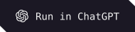
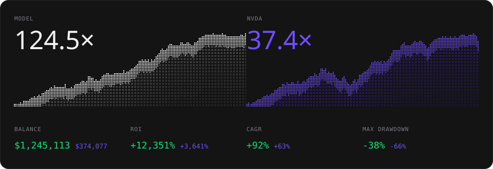
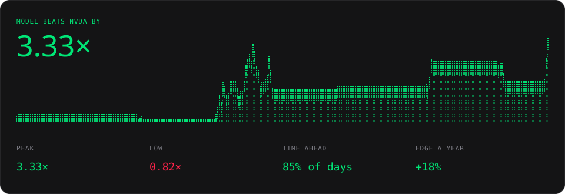
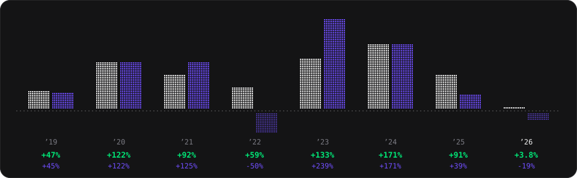
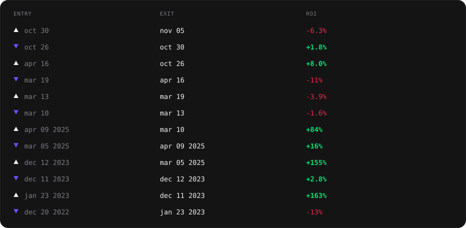

<h1 align="center">NVDA Two Key Turn</h1>

<p align="center">An open-source trading model for NVIDIA that runs in Claude or ChatGPT.</p>

<p align="center">
  <a href="https://tickerdb.com/go/claude/nvda-two-key-turn"></a>
  &nbsp;
  <a href="https://tickerdb.com/go/chatgpt/nvda-two-key-turn"></a>
</p>

<p align="center">Click a button above, or paste this into Claude in your browser (in ChatGPT, use the button above):</p>

```
Read https://tickerdb.com/run/nvda-two-key-turn and follow its steps. Once it's set up, schedule a daily check every day after 06:00 UTC that reads my model link and tells me only if the model bought or sold something.
```

<p align="center">No signup first and no API key to paste: the assistant gives you one link to approve (a free TickerDB account is created there if you are new), then shows you the model's record and checks it for you every day. Each check uses 5 TickerDB credits; the Free plan's 250 credits a month cover one daily check.</p>

<p align="center">
  Data: <a href="https://tickerdb.com">TickerDB</a>. Live record since activation: <a href="https://tickerdb.com/model/nvda-two-key-turn">tickerdb.com/model/nvda-two-key-turn</a>
</p>

<p align="center">
  
</p>

NVDA Two Key Turn returned +12,351% over the backtest, outperforming NVDA's +3,641% and ending 3.3× its result.

## Stats

<p align="center">
  
</p>

| | Model | NVDA |
|---|---:|---:|
| Balance from $10,000 | $1,245,113 | $374,077 |
| ROI | +12,351% | +3,641% |
| CAGR | +92% | +63% |
| Max drawdown | -38% | -66% |

From Jul 3, 2019 to Nov 18, 2026, valued at every daily close, after a 0.1% cost each way. The NVDA column is the stock bought at the Jul 3, 2019 close and held, dividends included.

NVDA Two Key Turn grew faster than NVDA (+92% vs +63% a year), with a shallower worst fall (−38% vs −66%).

## Edge

<p align="center">
  
</p>

The model's balance over NVDA's, day by day: above 1× it was ahead.

| | |
|---|---:|
| Model beats NVDA by | 3.33× |
| Peak | 3.33× (Nov 18, 2026) |
| Low | 0.82× (Apr 4, 2022) |
| Time ahead | 85% of days |
| Edge a year | +18% |

NVDA Two Key Turn beat NVDA by 3.3× and was ahead 85% of the time.

## Yearly ROI

<p align="center">
  
</p>

| Year | Model | NVDA |
|---|---:|---:|
| 2026 | +3.8% | -19% |
| 2025 | +91% | +39% |
| 2024 | +171% | +171% |
| 2023 | +133% | +239% |
| 2022 | +59% | -50% |
| 2021 | +92% | +125% |
| 2020 | +122% | +122% |
| 2019 | +47% | +45% |

The backtest starts on Jul 3, 2019 and ends on Nov 18, 2026, so 2019 and 2026 are part years. NVDA Two Key Turn beat NVDA in 4 of 8 years; its best year was 2024 at +171%.

## Trades

<p align="center">
  
</p>

The 12 most recent; all 29 are in [`results/trades.csv`](results/trades.csv). A trade is one long or one short in NVDA, from the open it was opened to the open it was closed; its return is after the 0.1% cost each way. NVDA Two Key Turn closed 29 trades: 62% won, and the average trade returned +26%.

## Rules

The model holds NVIDIA and flips to a short only when two keys turn together.

1. **Trend key:** NVDA's 100-day average is rising.
2. **Rates key:** the 2-year Treasury yield is above its level 126 sessions (about six months) earlier.
3. **Sell** NVDA and go short only when both keys turn: the 100-day average is not rising and rates are rising.
4. **Cover** the short and buy NVDA back as soon as either key clears.
5. Signals are checked once a day at the close and filled at the next open, 1x long or 1x short, with no leverage and no stop loss.

The parameters are at the top of [`model.py`](model.py).

## Run it yourself

With Claude Code, Codex, Cursor or another agent that runs code on your computer, paste this to clone the model and run it there on a schedule:

```
Clone github.com/tickerdb/nvda-two-key-turn and follow its README:
set up TickerDB using tickerdb.com/setup, then schedule run.py to run
every weekday at 05:00 UTC and tell me when it makes a trade.
```

## How the results are made

The figures above are the model's published record, the same one [its page](https://tickerdb.com/model/nvda-two-key-turn) shows: TickerDB runs these rules on its point-in-time data, marks the book at every daily close and publishes the result. [`readme.py`](readme.py) writes this README, its charts and `results/` from that record, and [`backtest.py`](backtest.py) replays the rules from the TickerDB API on its own and must make exactly the record's 29 trades, at the same prices.

```bash
export TICKERDB_API_KEY=tdb_...        # https://tickerdb.com/setup
python backtest.py                     # replays the rules on NVDA daily since 2019
python backtest.py --offline           # reruns the replay on the cached data/
python readme.py                       # fetches the published record and rewrites the README, charts and results/
python readme.py --check               # fails if anything here differs from the record, or the replay's trades do
python run.py                          # today's decision
python -m unittest discover -s tests   # offline tests of the rules and the record
```

The replay needs a TickerDB plan with daily history back to 2019 (Pro). No dependencies beyond Python 3.10+.

Point in time: each decision uses only data up to that day's close, and the order fills at the next session's open. The trend key is TickerDB's `trend_ma100_slope_pct` (the 100-day average's change over five sessions) and the rates key its `macro_treasury_yield_2y_pct`. A long or a short takes the whole balance at the open it fills, 1x; the cash held against a short earns nothing. Trade prices are as traded on the day: NVDA split 4-for-1 in 2021 and 10-for-1 in 2024, so older fills are at pre-split prices.

## Caveats

- **In-sample.** The rule and its parameters were chosen on the same 2019–2026 history they're tested on, so expect live results to be weaker.
- **Three shorts carry the edge.** Most of the gain over holding NVDA comes from the shorts of 2022, 2025 and November 2026. Several other flips were round trips of a few days while the 100-day average hovered around flat (March 2021).
- **The worst fall stays near 38%.** The March 2020 drop was not rate-driven, and the model held through it.
- **One stock.** No diversification, and no stop loss: a short loses for as long as NVDA rises against it.
- **Costs.** 0.1% each way. Shorts pay no borrow fees and earn no interest, and there's no extra slippage.
- **Point in time.** Each decision sees only data published by that day's close.
- Not investment advice. A backtest shows how a model would have done in the past; it doesn’t predict future results.

## License

MIT. The fonts embedded in the README images (Oxanium, Inter, JetBrains Mono, in `assets/fonts/`) are under the SIL Open Font License 1.1.
